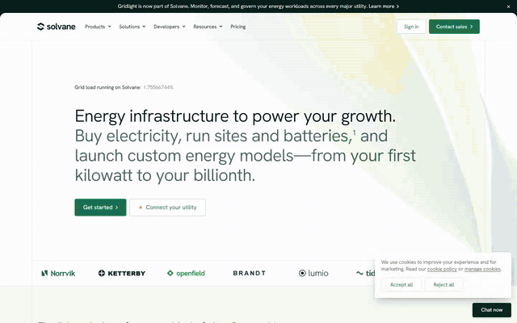

# Solvane

Website statis untuk **Solvane**, perusahaan fiktif penyedia infrastruktur energi (charging kendaraan listrik, tarif, baterai, pasar fleksibilitas, dan embedded energy untuk platform). Sasarannya armada, ritel, startup iklim, dan platform software. Ini rebuild orisinal yang terinspirasi tata letak dan perilaku sebuah situs SaaS referensi: konsep produk, brand, teks, gambar, warna, ikon, shader, dan kode dibuat baru.

Tone: putih hangat + evergreen gelap, aksen hijau, lime, dan emas.

## Halaman (52 file HTML)

| Halaman | Isi |
|---|---|
| `index.html` | Home: hero ribbon WebGL, 6 kartu produk dengan modal, konferensi, statistik interaktif, accordion, startup, platform, developer, berita, buku |
| `products.html` | Katalog produk dengan pencarian, filter, dan indeks samping |
| `product-sentinel.html` | Produk deteksi gangguan (hero gelap) |
| `product-charge.html`, `product-meter.html`, `product-pass.html`, `product-exchange.html`, `product-embed.html` | Halaman produk dengan sub-nav sticky |
| `pricing.html` | Paket Standard/Custom, tabel harga, FAQ |
| `enterprise.html`, `startups.html`, `platforms.html` | Halaman solusi |
| `developers.html` | Diagram integrasi, skala, jalur integrasi |
| `customers.html` | Daftar cerita pelanggan dengan filter |
| `customer-*.html` (17) | Detail tiap cerita pelanggan |
| `blog.html`, `blog-*.html` (6) | Daftar dan artikel blog |
| `newsroom.html`, `news-*.html` (7) | Daftar dan detail berita |
| `about.html`, `careers.html` | Tentang perusahaan dan lowongan |
| `contact-sales.html`, `sign-in.html` | Form demo (validasi lokal, tidak mengirim apa pun) |
| `legal.html`, `sitemap.html` | Teks hukum placeholder dan peta situs |

## Fitur dan interaksi

- Hero ribbon WebGL buatan sendiri (`js/wave.js`), dipakai juga di Contact dan Sign in.
- Mega menu saat hover dengan blur latar; menu mobile drill-in; bar pengumuman, banner cookie, dan chat demo.
- 6 kartu produk: terminal multi-bahasa, meter hidup, simulasi scan, kartu shader yang miring mengikuti kursor, globe titik dengan busur, carousel checkout. Klik membuka modal (tutup dengan X, Esc, atau klik di luar).
- Statistik: 4 visualisasi canvas (hover/klik) dan 6 mode waktu (Pre-dawn, Sunrise, Daytime, Dusk, Sunset, Night).
- Accordion, carousel drag, carousel berita yang "menyempit", testimoni otomatis, mock dashboard berurutan (dengan replay), diagram integrasi, gelombang garis, dan editor kode.
- Katalog dan daftar dengan filter, sub-nav sticky dengan progress, form bertahap.
- Scroll native; animasi hanya berjalan saat elemennya terlihat; `prefers-reduced-motion` dihormati. Tanpa sound.
- Responsif desktop (1440) sampai mobile (390).

## Teknologi

HTML, CSS, dan JavaScript native. Tanpa framework dan tanpa build. Font lokal: **Hanken Grotesk** (pengganti terdekat untuk font berlisensi di referensi, selisih lebar sekitar 1%) dan **Source Code Pro**.

## Cara menjalankan

Buka `index.html` langsung di browser.

## Struktur

```
.
├── *.html                 52 halaman
├── css/
│   ├── site.css           token warna, header, menu, footer, tombol
│   ├── home.css           home + modal + developers
│   ├── new.css            katalog, Sentinel, about, contact
│   ├── inner.css          product, pricing, solusi, customers, blog, newsroom
│   └── mocks.css          mock UI kecil
├── js/
│   ├── site.js            perilaku bersama
│   ├── home.js            canvas, modal, carousel
│   ├── wave.js            ribbon WebGL
│   └── land.js            data daratan untuk globe
├── assets/
│   ├── favicon.svg
│   ├── fonts/             2 file woff2
│   └── img/               gambar
└── docs/preview/          homepage.gif, hero.png
```

## Mengedit

Tidak ada generator: edit langsung file HTML/CSS/JS.

- **Teks**: di HTML halaman terkait. Header dan footer ada di setiap HTML; ubah dengan cari-ganti di semua file.
- **Warna**: variabel di `:root` pada `css/site.css`, dan `.ip` pada `css/inner.css`. Warna ribbon: array `SHEETS` di `js/wave.js`. Mode waktu: objek `T` di `js/home.js`.
- **Gambar**: timpa file di `assets/img/` dengan nama sama (`wide-*`, `news-*`, `blog-*`, `startup-*`, `story-*`, `about-*`, `face-*`, `thumb-*`, `silk-*`, `book-1`, `menu-1`).
- **Logo**: SVG inline di `.logo`, dan `assets/favicon.svg`.

## Placeholder yang perlu diganti

Nama Solvane dan badan hukumnya, telepon `+1 (555) 014-0199`, `press@solvane.example`, semua nama pelanggan, orang, kutipan, angka, dan harga, nama konferensi dan buku, teks `legal.html`, serta tujuan form, chat, dan sign-in. Produk katalog yang belum punya halaman sendiri mengarah ke Contact sales.

## Kredit aset

- Gambar foto/ilustrasi: dihasilkan AI (Nano Banana via Google Flow). `silk-1..3.jpg` dirender dari shader buatan sendiri.
- Data daratan globe: Natural Earth 1:110m (domain publik).
- Font: Hanken Grotesk dan Source Code Pro, SIL Open Font License (Google Fonts).

## Keterbatasan

- Shader, visualisasi, dan globe adalah pendekatan sendiri: karakternya mirip, bukan identik.
- Posisi home di 1440 px diukur terhadap referensi; halaman dalam dan mobile dicocokkan secara visual, dengan beberapa section dipadatkan.
- Referensi punya ratusan halaman; yang dibuat satu contoh per template utama beserta halaman detail yang tertaut di situs ini.
- Semua form dan chat hanya demo.
